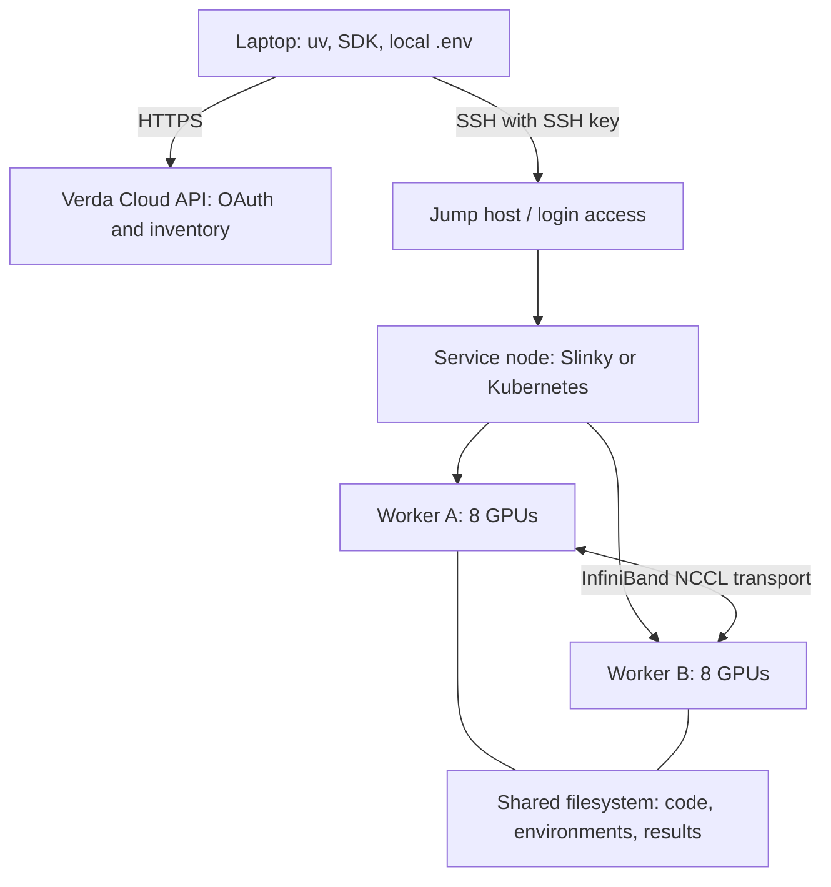

# Verda setup and architecture

The local client is ready. Account authentication and Verda GPU execution await your keys; no infrastructure or jobs were created. The official Python SDK is pinned to `verda==1.25.0` with `python-dotenv==1.2.4` in the optional `verda` extra. Its inspected source is under `upstream/verda-sdk`, with commit recorded in `upstream.json`; imports use the locked PyPI package. Verda's separate official CLI is written in Go. [Python SDK](https://github.com/verda-cloud/sdk-python), [official CLI](https://docs.verda.com/cli/).

## Credentials and commands

The local `.env` exists with empty fields and owner-only permissions. Fill `VERDA_CLIENT_ID` and `VERDA_CLIENT_SECRET` there; `VERDA_LOCATION` defaults to `FIN-03`. Use Cloud API credentials from the console, which differ from hosted Inference API Keys. `.env` is ignored; `.env.example` contains placeholders. Process variables override the file, whose values are loaded without shell execution or interpolation. [Credentials](https://docs.verda.com/welcome-to-verda/api-credentials/).

```bash
uv sync --frozen --extra verda
uv run --extra verda python verda_cli.py doctor
# After filling .env:
uv run --extra verda python verda_cli.py doctor --online
uv run --extra verda python verda_cli.py clusters --output results/verda/clusters.json
uv run --extra verda python verda_cli.py catalog --output results/verda/catalog.json
uv run --extra verda python verda_cli.py availability --kind cluster --location FIN-03
```

Use `clusters ACTUAL_CLUSTER_ID` for worker details, and `images --kind cluster --type ACTUAL_TYPE` after selecting a type from the catalog. `instances`, `ssh-keys` and `balance` are also supported. `available: false` reports lack of capacity, not a failed query. Inventory output can contain infrastructure addresses; retain it locally.

`doctor` is offline unless `--online` is supplied and reports credential presence only. The SDK constructor eagerly authenticates, so offline checks never construct it. Online commands obtain OAuth tokens and read inventory. No create/delete/job-submission methods are exposed. Connect timeout is five seconds; read timeout defaults to 30 seconds, configurable with `--timeout`. Tokens are not persisted. [API reference](https://api.verda.com/v1/docs).

## Cloud API, scheduler and GPU fabric



The SDK manages infrastructure; SSH and the cluster scheduler launch your actual computation. API credentials and SSH keys serve different purposes.

Public Instant Clusters document H200/B200/B300, 16-128 GPUs, a jump host, a service node, and inter-worker InfiniBand, currently in FIN-03. This differs from the rack-wide NVLink domain discussed for NVL72. A cluster's GPU count does not establish one load/store-accessible peer-memory team. Inspect actual topology and NCCL team membership. The overview says PAYG while the deployment guide mentions a one-day starting duration; confirm live terms before provisioning. [Cluster architecture](https://docs.verda.com/clusters/instant-clusters/), [deployment](https://docs.verda.com/clusters/instant-clusters/deploying-your-cluster/).

Start on one B200 worker with 1, then 2/4 GPUs. Keep LSA within a verified peer-access domain. Across workers, validate ordinary NCCL over InfiniBand first; device-initiated networking needs supported NCCL GIN transport and a separate protocol. Storage and Ethernet control paths do not replace GPU communication.

### Slinky / Slurm

Slinky runs Slurm on Kubernetes, with eight GPUs per worker. Use `srun` and `sbatch`. Current docs put the Slurm login pod on SSH port 22 and the admin host on 2222; pre-October-2026 clusters may reverse those ports. Confirm the existing configuration. The login environment has no GPUs: request them through Slurm. [Slinky architecture](https://docs.verda.com/clusters/instant-clusters/slinky/), [access and jobs](https://docs.verda.com/clusters/instant-clusters/slinky/getting-started/).

Jobs enter a per-job jail with a shared writable root filesystem. Keep uv environments under `/home`, avoiding system package changes that affect other jobs. `/home` is shared; `/shared` holds datasets; `/local` is worker-local NVMe persisting across jobs; `/tmp` is private scratch removed at job end. GPU visibility is limited to your allocation. [Execution jail](https://docs.verda.com/clusters/instant-clusters/slinky/shared-jail/).

Use Apptainer with `--nv` inside Slurm steps for containers. Save reusable SIF images under `/home`, with conversion/cache scratch on local storage. In-job Docker and Pyxis `srun --container-image` are unavailable in this documented configuration. Verify CUDA/NCCL/HPC-X and RDMA visibility inside the actual container. [Containers](https://docs.verda.com/clusters/instant-clusters/slinky/containers/).

### Kubernetes

The Kubernetes option includes GPU/Network operators, MPI Operator and Kueue. [Architecture](https://docs.verda.com/clusters/instant-clusters/kubernetes/).

MPIJobs need GPU and `rdma/rdma_shared_device_a` resources, `IPC_LOCK`, adequate `/dev/shm`, and placement across physical workers. MPI worker images need `/usr/sbin/sshd`; standard NGC images lack it. PyTorchJob requires a separately installed Training Operator. Verda documents `NCCL_IB_PKEY=1` for H200/B200; B300 uses default index 0, so do not force 1 there. Prefer the staged hardware-specific examples. Their NCCL 2.29.3 test image is a transport baseline, not our NCCL4Py 0.6.0 / NCCL 2.32.3 environment. [Multi-node workloads](https://docs.verda.com/clusters/instant-clusters/kubernetes/workloads/).

## First single-worker experiment

These are instructions for an existing Slinky cluster, not jobs executed during setup. Transfer the project to `/home/ubuntu/dist-megamind`, excluding `.env`, local virtualenvs and generated results. GPU workers do not need Cloud API credentials. Stage pinned engine sources separately when needed.

```bash
ssh ubuntu@CLUSTER_IP
srun --nodes=1 --ntasks=1 --gres=gpu:1 --time=00:15:00 --pty bash
cd /home/ubuntu/dist-megamind
uv sync --frozen --extra gpu
nvidia-smi -L
nvidia-smi topo -m
uv run --extra gpu python experiment.py env --output results/verda-env-1
uv run --extra gpu python experiment.py cute --output results/verda-cute-1
```

Dependency setup may exceed the short allocation: prepare the environment in advance or use a prepared container. Run GPU checks inside the scheduled step. The pinned research stack targets B200/SM100a; H200/B300 compatibility needs separate validation.

After the one-GPU checks pass, exit that interactive step and request two GPUs on one worker. Run each check separately and inspect results:

```bash
srun --nodes=1 --ntasks=1 --gres=gpu:2 --time=00:15:00 --pty bash
cd /home/ubuntu/dist-megamind
uv run --extra gpu torchrun --standalone --nproc-per-node=2 experiment.py nccl --output results/verda-nccl-2
uv run --extra gpu torchrun --standalone --nproc-per-node=2 experiment.py symmetric --output results/verda-lsa-2
```

Save allocation ID, worker names, topology, logs, environment and source hashes alongside rank JSON. These commands consume cluster resources; none has been run here.

The current harness assumes one host: `LOCAL_RANK` selects both CUDA device and communicator rank. Before multi-node execution, separate global `RANK` from `LOCAL_RANK`, configure rendezvous and launch, make output paths unique across global ranks, and remove the assumption that one LSA team spans the world. Increasing `WORLD_SIZE` alone would be incorrect.

## Megakernels and the vLLM swap

CuTe DSL expresses tile math, layouts, pipelines and scheduling. NCCL host calls establish communicators and registered buffers; supported device APIs allow communication from a running kernel. A megakernel fuses multiple operations, potentially including communication, into one GPU launch. Each GPU still runs its own participating kernel.

This repo has CuTe addition and a host-synchronized LSA probe, not optimized attention. Build local attention first, then prove peer payload/ready/ack ordering and buffer reuse, then overlap communication and math, then add distributed attention and balancing. Test changed inputs, delayed ranks, grids exceeding residency and graph replay before timing. [Experiment sequence](experiments.md).

The vLLM hook replaces a selected native attention callable at worker import. `DIST_VLLM_ATTENTION=stock` uses native attention; `kernels:my_vllm_attention` imports your function once implemented. Restart all workers after changing selection or source. vLLM continues scheduling requests, projecting Q/K/V, managing paged KV storage and supplying metadata. Your function must honor the signature, ragged/paged layouts, masks, LSE and caller-owned output contract.

`server_experiment:reference_attention` is the tested replacement: slow independent PyTorch attention verified through real vLLM HTTP prefill/decode on one B200. It proves routing and numerical integration, not CuTe performance. A local-call swap leaves enclosing collectives in place; fused context parallelism requires replacing the enclosing backend/orchestration while preserving cache ownership. Keep research, vLLM and DeepInfer environments separate. [Exact hooks, restoration, validation and benchmarks](serving.md).

After correctness, verify Nsight tools and counter access inside the actual job/container. Use Nsight Systems for the timeline and isolated local-kernel Nsight Compute captures; mutually waiting distributed kernels need replay-aware collection. Instance-image profiling support does not prove cluster-job permissions. [Profiling guide](https://docs.verda.com/cpu-and-gpu-instances/profile-with-nsight/).

## Validation

Seven client tests cover offline behavior, literal dotenv values, missing keys, the real SDK's mocked OAuth/cluster HTTP contract, timeouts, redaction, inventory reads and JSON output. The public API answered an unauthenticated TLS GET with HTTP 401, proving reachability only. Account access, scheduler/topology and Verda GPU execution remain pending.

```bash
uv run --extra verda python -m unittest -v test_verda_cli test_server_experiment
```

Local setup evidence is in `results/verda/setup.json`.
